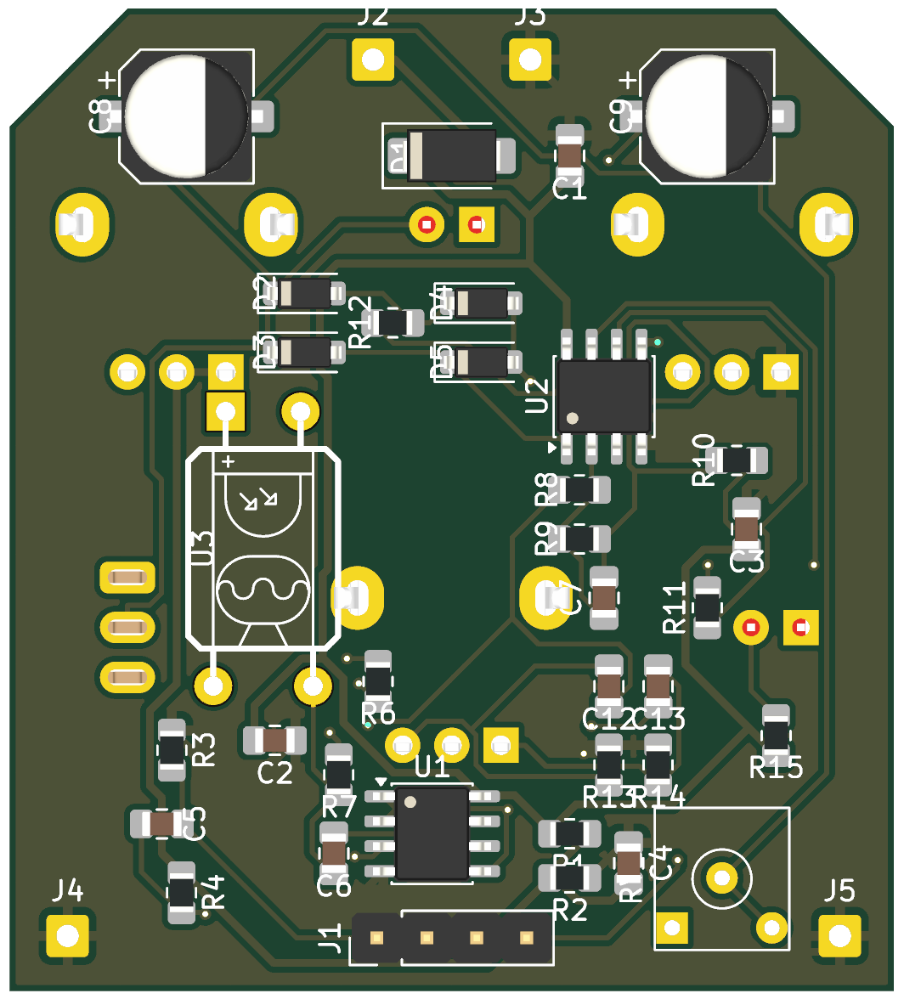

# Flatline+ (1590B)

An optical compressor for guitar, built on John Hollis's Flatline with Atomium Amps' mods and your OPA2134 build (super-freq.com/flatline-op2134). Added:
- BLEND (parallel compression);
- a gain-reduction LED;
- a RELEASE switch;
- a side chain buffered off the audio path.

SMD parts are assembled by JLCPCB; the panel parts are hand-soldered on the back.

## Controls

| Control | Part | What it does |
|---|---|---|
| SUSTAIN | RV1 A100k | Gain into the optical gain cell (×3 to ×23): more sustain, more squash |
| BLEND | RV3 B100k | Dry ↔ compressed |
| VOLUME | RV4 A100k | Output level |
| RELEASE | SW1 sub-mini SPDT | FAST 220 µF (stock) / SLOW 440 µF |
| **TIGHT** | SW2 sub-mini SPDT | Side-chain high-pass (C14 100n with R8 10k, ~160 Hz): bass notes stop pumping the compressor. Switch closed = off (C14 shorted) |
| GR LED | D6 | Glows as hard as it's compressing |
| ON LED | D7 | Lit by the footswitch (LED_K) |
| Trim | RV2 3362P 1k | LED-string current (the original POT1) |

## Board

- **Outline and drilling:** the Trem v2 board outline (45 × 50 mm) and its 1590B panel grid.
  - Top row: SUSTAIN · GR LED · ON LED · VOLUME (the two LEDs 6 mm apart in the centre).
  - Middle: RELEASE · BLEND · TIGHT (TIGHT uses the Trem v2's second toggle hole).
  - Bottom: footswitch.
  - Drill files: `enclosure/` (Tayda CSV + 1:1 template).
- **Wiring:** a 1×4 header (IN / LED / GND / OUT) runs straight to SwitchPCB v2. There are 9V/GND pads, and IN GND / OUT GND pads for the jack sleeves.
- **Op-amps:** U1 OPA2134UA (LCSC C87361, extended) for audio; U2 TL072 (C6961) for the side chain.
- **Vactrol (U3):** Xvive VTL5C3, or a DIY LED + LDR in heat-shrink. It stands vertically between RELEASE and BLEND.
- **Release caps:** C8/C9 are 220 µF DMBJ (C970695), with `FT Rotation Offset 180` so JLC places them the right way round.

Design notes: [docs/Design Notes.md](docs/Design%20Notes.md). Schematic: [docs/Flatline_schematic.pdf](docs/Flatline_schematic.pdf).

## Status

- **2026-10-07:** schematic and board done.
  - ERC 0.
  - DRC 0 errors, 0 unconnected, schematic parity 0. Only silkscreen warnings remain.
  - GND pours on both layers.
- **2026-10-18: TIGHT switch added** (C14 100n + SW2). The ON LED moved to the top row beside the GR LED; C1 / C3 / R15 were nudged; re-routed.
  - DRC: 0 errors, 0 unconnected; board and schematic connectivity identical (27 nets).
  - The CLI parity "net_conflict" items are KiCad 10 auto-net names only. Press F8 in KiCad once to clear them and SW2's Datasheet field.
- **Next:** your silkscreen pass, then the JLC fab files.

## Files

- `scripts/`:
  - `build_flatline.py`: the schematic;
  - `buildpcb_flatline.py`: placement;
  - `nudge.py`: clears overlaps.

  Don't re-run them after editing the board in KiCad.
- **Routing:** with `_tools/autoroute.py`.
